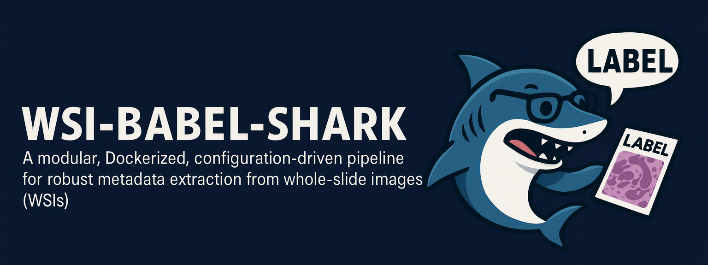

# WSI-Babel-Shark  

## Overview

**WSI-Babel-Shark** is an advanced, next-generation digital pathology pipeline designed to extract, decode, and structure metadata from heterogeneous whole-slide image (WSI) labels.  
It succeeds and extends **WSI-BabelFish** by introducing a fully modular architecture, unified YAML-driven orchestration, integrated DataMatrix + OCR engines, stain detection, a layout classifier, and optional GUI-based ROI annotation.

Developed at the **Computational Pathology Section, Institute of Pathology, Heidelberg University**, Babel-Shark supports:

- SVS, NDPI, MRXS, SCN, BIF, TIFF, PNG, JPEG formats  
- Automated WSI ingestion and label extraction  
- DataMatrix decoding + ROI-based fallback OCR  
- Layout-aware metadata parsing  
- Stain classification  
- Standardized SlideID generation  
- Integrated **SQLite + Excel** registry output  
- Fully Dockerized execution (Linux, macOS, Windows)

The objective is to transform unstructured slide labels into **clean, queryable, machine-readable metadata**, enabling large-scale digital pathology research, automation, and archive digitization.

##  Pipeline Overview

The following diagram illustrates the complete WSI-Babel-Shark workflow  
—from slide ingestion to metadata extraction, ROI/OCR fallback, stain detection,  
and final SlideID generation:


---

## Features

- **Unified CLI** (`babel-shark-cli`) orchestrating all modules  
- **YAML-configurable** pipeline logic  
- Robust **DataMatrix decoding** with ROI-OCR fallback  
- Automatic **label region extraction**  
- Modular **layout classifier** for structured ROI detection  
- **Stain recognition** (H&E / IHC patterns)  
- Standardized **SlideID** generation and WSI renaming  
- **SQLite registry** + Excel export for biobanking workflows  
- Reproducible **Docker deployment**  
- Optional **ROI-Annotator GUI** for dataset curation  
- Built-in **demo configs** for quick testing  

---

## Pipeline Architecture

Core modules:

1. **collect** – WSI ingestion from watch directory  
2. **label** – Label/macro extraction  
3. **dm** – DataMatrix decoding  
4. **extract** – ROI-based OCR fallback  
5. **stain** – Stain type classification  
6. **slideid** – SlideID construction and renaming  
7. **db** – SQLite registry + Excel sync  
8. **pipeline** – Full orchestrated run (all stages)

Documentation for each module is located in:

```
docs/
  installation.md
  docker.md
  configuration.md
  pipeline.md
  layout-classifier.md
  roi-annotator.md
```

---

## Installation (Local, Non-Docker)

### 1. Clone repository
```bash
git clone https://github.com/cpheidelberg/WSI-Babel-Shark.git
cd WSI-Babel-Shark
```

### 2. Create environment
Linux/macOS:
```bash
python3 -m venv .venv
source .venv/bin/activate
pip install --upgrade pip
```

Windows PowerShell:
```powershell
python -m venv .venv
.\.venv\Scripts\Activate.ps1
pip install --upgrade pip
```

### 3. Install in editable mode
```bash
pip install -e .
```

### 4. Run pipeline
```bash
babel-shark-cli pipeline run --config ./config/config.yaml
```

---

## Docker Usage

### 1. Pull the image
```bash
docker pull bioinfo2026/wsi-babel-shark:latest
```

### 2. Basic test
```bash
docker run --rm bioinfo2026/wsi-babel-shark:latest --help
```

### 3. Built-in dry-run (no slides required)
Linux/macOS:
```bash
mkdir -p /tmp/wsi/slides /tmp/wsi/output

docker run --rm \
  -v /tmp/wsi/slides:/slides \
  -v /tmp/wsi/output:/output \
  bioinfo2026/wsi-babel-shark:latest \
  pipeline run --config /app/config/config.docker.demo.yaml
```

Windows PowerShell:
```powershell
mkdir C:\wsi\slides
mkdir C:\wsi\output

docker run --rm `
  -v "C:\wsi\slides:/slides" `
  -v "C:\wsi\output:/output" `
  bioinfo2026/wsi-babel-shark:latest `
  pipeline run --config /app/config/config.docker.demo.yaml
```

### 4. User-defined run
```bash
docker run --rm \
  -v /path/to/slides:/slides \
  -v /path/to/output:/output \
  -v /path/to/config.yaml:/config/config.yaml:ro \
  bioinfo2026/wsi-babel-shark:latest \
  pipeline run --config /config/config.yaml
```

---

## Output Structure

Typical output folder:

```
output/
  <timestamp>/
    pipeline_*.log
    slide_metadata.xlsx
    WSI-Babel-Shark.sqlite
    roi_debug/
    datamatrix/
    labels/
    stains/
```

---

## Label Layout Classifier

WSI-Babel-Shark includes a dedicated **Label Layout Classifier** for automatic recognition of heterogeneous whole-slide image label layouts before ROI-based OCR. The classifier assigns each label image to one of the predefined layout groups (G1–G10), enabling automatic selection of the appropriate ROI template for downstream metadata extraction.

Unlike conventional closed-set classifiers, the system uses an **open-set recognition** strategy, allowing previously unseen or non-standard label layouts to be rejected instead of being incorrectly assigned to an existing class.

The classifier combines multiple complementary features:

- ResNet-18 CNN feature embeddings
- Handcrafted layout descriptors
- Average-image similarity
- Threshold-based unknown-layout rejection

This hybrid approach provides robust recognition across diverse scanner vendors and label designs while maintaining reliable rejection of unfamiliar layouts.

---

### Graphical User Interface (GUI)

A standalone graphical application is provided for users without programming experience.

<p align="center">
  
</p>

The GUI provides a complete workflow for training, validating and using the classifier, including:

- Dataset splitting
- Feature index generation
- Automatic threshold learning
- Validation
- Single-image prediction
- Batch prediction
- Batch evaluation
- Confusion matrix generation
- Excel report generation
- Configuration editor
- Portable Windows execution (no Python installation required)

Repository:

https://github.com/cpheidelberg/label-layout-classifier

---

### Portable Windows Release

A pre-built standalone Windows version is available from:

https://github.com/cpheidelberg/label-layout-classifier/releases/latest

Download:

```text
BabelShark-Full-Windows.zip
```

After extracting the archive, simply run:

```text
BabelShark-Full.exe
```

No Python installation or additional dependencies are required.

---

### Typical Workflow

1. Prepare a labeled training dataset.
2. Build the feature index.
3. Learn the optimal acceptance thresholds.
4. Validate classifier performance.
5. Predict the layout of individual images or entire folders.
6. Evaluate the classifier and generate performance reports.


## ROI-Annotator GUI

A lightweight cross-platform GUI for manual ROI creation and dataset curation.

Download:  
https://github.com/Shahram-Bioinfo/ROI-Annotator/releases

---

## Typical Workflow

```bash
babel-shark-cli collect run --config ./config/config.yaml
babel-shark-cli label run --config ./config/config.yaml
babel-shark-cli dm run --config ./config/config.yaml
babel-shark-cli extract run --config ./config/config.yaml
babel-shark-cli stain run --config ./config/config.yaml
babel-shark-cli slideid run --config ./config/config.yaml
babel-shark-cli pipeline run --config ./config/config.yaml
```


## Citation 

Aliyari S, Wagner M, Weis C-A.  
**WSI-Babel-Shark: A modular pipeline for robust metadata extraction from heterogeneous whole-slide image labels in digital pathology.**  
Computational Pathology Section, Institute of Pathology, Heidelberg University; 2026.

---

## Authors

**Shahram Aliyari** — First Author & Corresponding Author
**Maximilian Wagner** — Co-Author  
**Prof. Cleo-Aron Weis** — Senior 

Contact: shahram.aliyari@med.uni-heidelberg.de

---

## License
MIT License.

---

## Related Tools

- ROI-Annotator — https://github.com/Shahram-Bioinfo/ROI-Annotator  
- WSI-BabelFish — https://github.com/ComputationalPathologyHeidelberg/WSI-BabelFish  
- Docker Hub — https://hub.docker.com/r/bioinfo2026/wsi-babel-shark  


